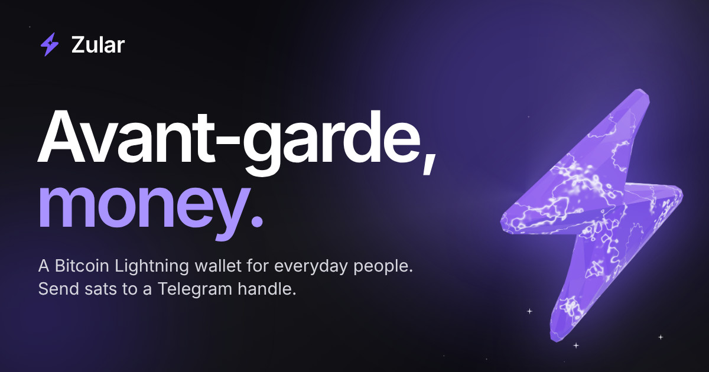

<div align="center">

<a href="https://zular.net">
  <picture>
    <source media="(prefers-color-scheme: dark)" srcset="public/brand-assets/logos/zular-logo-on-dark.svg" />
    
  </picture>
</a>

### Avant-garde, money.

The website for **Zular**, a Bitcoin Lightning wallet for everyday people.

[](https://github.com/zular-net/website/actions/workflows/deploy.yml)
[](https://zular.net)
[](LICENSE)

[Website](https://zular.net) · [Media assets](https://zular.net/media/) · [X](https://x.com/zular_net) · [Telegram](https://t.me/zular_net) · [Nostr](https://npub.world/_@zular.net)



</div>

## ⚡ Quick start

You need **Node.js 22.6 or newer**.

```sh
npm install
npm run dev        # http://localhost:5173
```

Or run the production build in Docker:

```sh
docker compose up --build
```

## 🧰 Commands

| Command           | What it does                                               |
| ----------------- | ---------------------------------------------------------- |
| `npm run dev`     | Starts the dev server with hot reload                      |
| `npm run check`   | Runs everything CI runs: format, lint, types, tests, build |
| `npm run build`   | Builds the site into `dist/`, with each page prerendered   |
| `npm run preview` | Serves the built site locally                              |
| `npm test`        | Runs the logic tests in `test/`                            |
| `npm run format`  | Fixes formatting                                           |

Run `npm run check` before you push.

## 🚀 Publishing

Every push to `main` publishes to **https://zular.net** once CI passes:

1. **Build:** format, lint, type check, tests, then the Vite build and `scripts/check-build.js`.
2. **Publish:** the `dist/` folder goes to GitHub Pages.
3. **Check live:** the site is checked over HTTPS, including the Nostr file and `robots.txt`.

The workflow is `.github/workflows/deploy.yml`. The domain runs through Cloudflare's proxy with SSL set to Full.

## ✏️ Change the content

| To change                               | Edit                                                 |
| --------------------------------------- | ---------------------------------------------------- |
| Links, socials, donation address, email | `src/config.ts`                                      |
| Page titles, descriptions, share images | `src/lib/seo.ts`                                     |
| Home page sections                      | `src/pages/home/sections/`                           |
| Sample activity, offers, fees, roadmap  | `src/pages/home/examples.ts`                         |
| Media page text and asset lists         | `src/pages/media/content.ts`, `public/brand-assets/` |
| Nostr identity (`_@zular.net`)          | `public/.well-known/nostr.json`                      |
| Colors, radii, fonts                    | `src/styles/global.css`                              |

Blank values in `src/config.ts` stay hidden or show "Coming soon".

## 🗂️ How it's organised

```text
src/
├── pages/         home and media, each with its own content and navigation
├── components/    ui, card, layout and bolt (the 3D scene)
├── lib/           logic with no UI, tested in test/
├── hooks/         React hooks
└── styles/        tokens that mirror the Figma variables
scripts/           prerendering and build checks
public/            fonts, the 3D model, share images and brand assets
```

## 🔩 The 3D bolt

`public/models/zular-bolt-v3a.glb` is the real brand model. It renders live with three.js, and `BoltAnchor` marks each place it flies to as the page scrolls.

three.js loads as its own chunk after the page is usable. If WebGL is missing, the model can't load or the graphics context is lost, each anchor shows the flat logo instead.

## 🎨 Design

The design lives in the Zular Figma file, on the **Product** page, in the **Website** section. The tokens in `src/styles/global.css` mirror its variables.

## 🤝 Working on it

Read [AGENTS.md](AGENTS.md) first, whether you're a person or an AI agent. It covers the product rules (custodial wording, the real 3D bolt, labelled examples) and the code rules.

## 📄 License

[MIT](LICENSE) © Zular
